<p align="center">
  
</p>

<h1 align="center">Click Seguro</h1>

<p align="center">
  <b>Aplicativo que ajuda pessoas idosas a reconhecer golpes digitais e notícias falsas.</b><br>
  Trabalho de Conclusão de Curso · Análise e Desenvolvimento de Sistemas · FATEC
</p>

<p align="center">
  
  
  
  
</p>

---

## Sumário

- [O problema](#o-problema)
- [O que o app faz](#o-que-o-app-faz)
- [Telas](#telas)
- [Acessibilidade](#acessibilidade)
- [Como rodar o projeto](#como-rodar-o-projeto)
- [Testes e qualidade](#testes-e-qualidade)
- [Stack tecnológica](#stack-tecnológica)
- [Arquitetura](#arquitetura)
- [Como o projeto foi desenvolvido](#como-o-projeto-foi-desenvolvido)
- [Estrutura do repositório](#estrutura-do-repositório)

---

## O problema

Golpes digitais, como o do falso parente no WhatsApp, a falsa central do banco, o Pix e os links
de phishing, atingem com mais força o público **idoso**. Essas pessoas têm menos familiaridade com
o ambiente digital e mais dificuldade para ler em telas pequenas. Quando são abordadas, faltam três
coisas:

- **informação confiável** e fácil de entender sobre os golpes do momento;
- **treino prático** para reconhecer uma abordagem suspeita antes de cair nela;
- **um caminho rápido para pedir ajuda** à polícia, ao banco ou a um familiar.

## O que o app faz

O Click Seguro reúne essas três frentes num só lugar:

| Frente | O que a pessoa encontra |
| :--- | :--- |
| 📰 **Informar** | Notícias sobre golpes separadas por categoria, busca, Reels para leitura rápida e alertas quando sai uma notícia nova. |
| 🎓 **Educar** | Atividades em módulos, com perguntas práticas de múltipla escolha, explicação depois de cada resposta, progresso e conquistas. |
| 🆘 **Socorrer** | Central de ajuda com botão de ligar para o 190, contatos oficiais e contatos pessoais de confiança, com ligação em um toque. |
| 🤖 **Tirar dúvidas** | Assistente que responde perguntas sobre golpes e verifica mensagens e imagens suspeitas. |

Também é possível usar o app **sem criar conta**, como visitante. A conta guarda o progresso, as
notícias salvas e as curtidas. Ao criar uma conta, o que a pessoa já respondeu como visitante passa
para ela.

## Telas

As capturas abaixo foram feitas no app real, num Samsung Galaxy S24, usando uma conta de teste.

### Entrada

| Login | Cadastro |
| :---: | :---: |
| 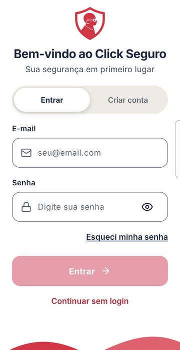 | 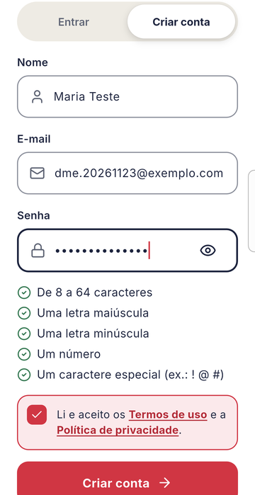 |
| Entrar com e-mail e senha ou continuar sem login | Regras de senha conferidas enquanto a pessoa digita e aceite dos Termos de uso |

### Notícias

| Início | Destaques | Notícia | Reels |
| :---: | :---: | :---: | :---: |
| 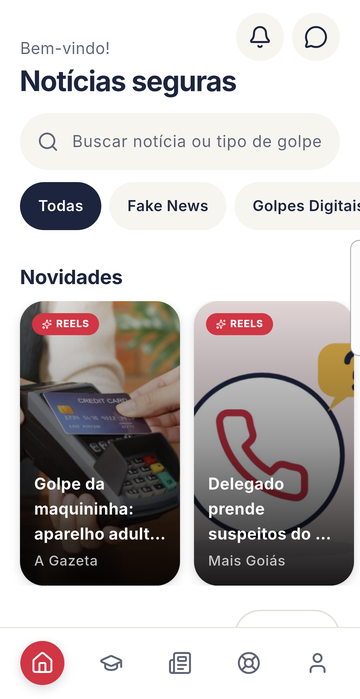 | 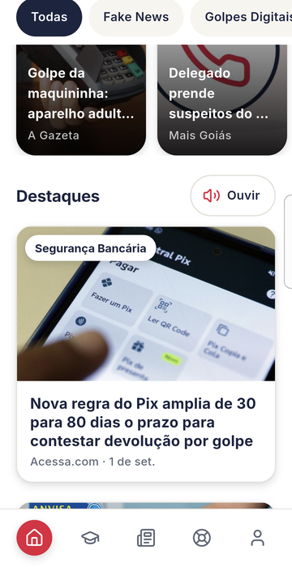 | 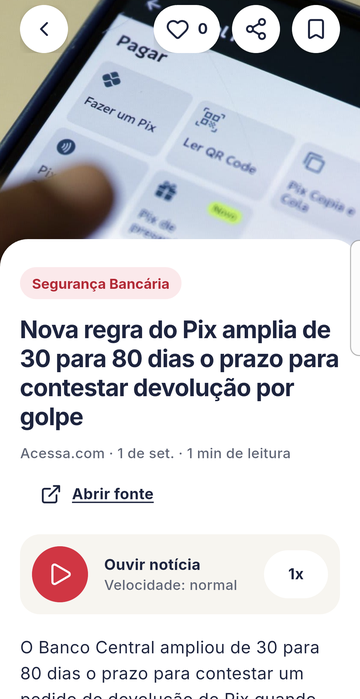 |  |
| Busca, categorias e novidades | Destaques com leitura em voz alta | Notícia completa, fonte, curtir, salvar e "Ouvir notícia" | Notícias curtas, uma por tela |

### Atividades

| Painel | Pergunta | Resposta |
| :---: | :---: | :---: |
| 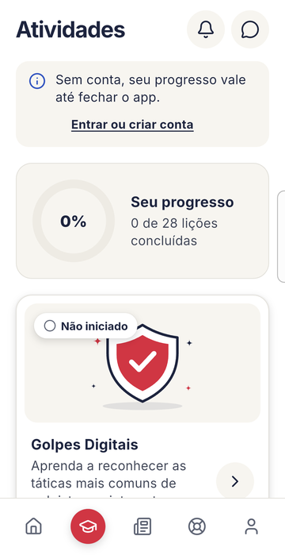 | 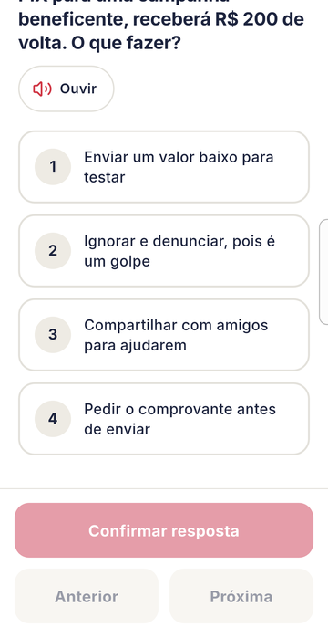 | 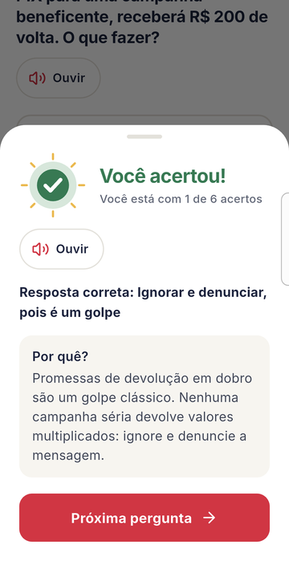 |
| Progresso geral e módulos | Situação real com alternativas numeradas | Acerto ou erro, a resposta certa e o porquê |

### Ajuda, assistente e conta

| Central de ajuda | Assistente | Perfil |
| :---: | :---: | :---: |
| 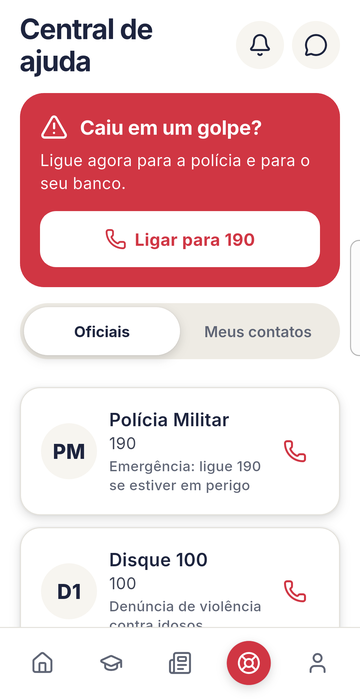 | 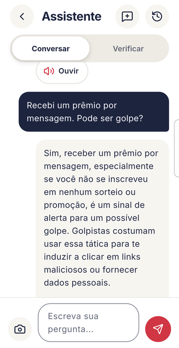 | 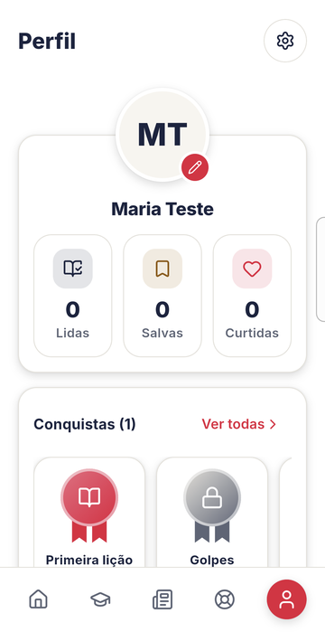 |
| "Caiu em um golpe?", contatos oficiais e pessoais | Perguntas sobre golpes, com resposta em voz alta | Notícias lidas, salvas e curtidas e conquistas |

| Configurações | Acessibilidade | Sem internet |
| :---: | :---: | :---: |
| 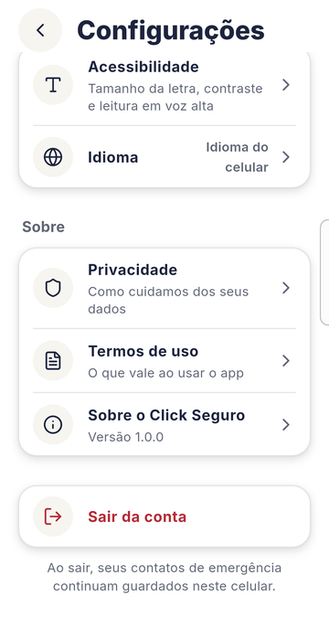 | 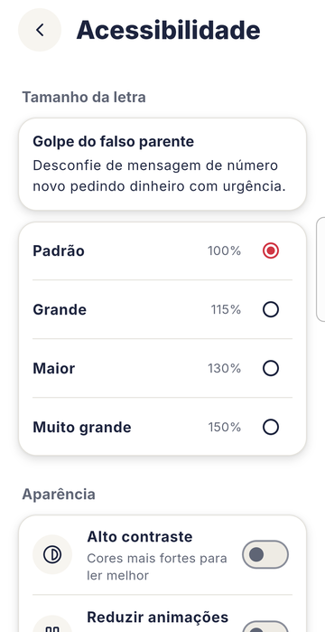 | 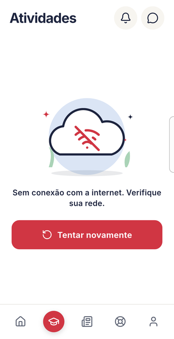 |
| Acessibilidade, idioma, privacidade e termos | Tamanho da letra, alto contraste e menos animação | O mesmo aviso em todas as telas, com "Tentar novamente" |

## Acessibilidade

O público principal são pessoas idosas, por isso a acessibilidade faz parte de todas as telas:

- **Letra ampliável** em quatro tamanhos (100% a 150%), com as telas se reorganizando para não
  cortar o texto.
- **Alto contraste**, que reforça as cores de todo o app.
- **Leitura em voz alta** ("Ouvir") em notícias, Reels, perguntas, respostas e no Assistente, com
  leitura automática opcional.
- **Reduzir animações** para quem se incomoda com movimento.
- Botões com área de toque de pelo menos 48 × 48, texto base de 16 e suporte ao leitor de tela
  (TalkBack/VoiceOver).
- **Funciona sem internet** no que já foi carregado: últimas notícias, notícias salvas e central de
  ajuda. Quando falta conexão, o aviso é sempre o mesmo, em todas as telas.
- App em **português e inglês**.

## Como rodar o projeto

### Pré-requisitos

- [Flutter](https://docs.flutter.dev/get-started/install) 3.47 ou mais novo (Dart 3.11)
- Android Studio com um emulador, ou um celular Android com a depuração USB ligada
- Para iOS: macOS com Xcode

### Passo a passo

```bash
git clone https://github.com/amandaduara/click-seguro-app.git
cd click-seguro-app/click_seguro_app
flutter pub get
flutter run
```

O app já vem apontando para o servidor de desenvolvimento
(`https://clickseguro-api.onrender.com/api/v1`). Para usar outro servidor:

```bash
flutter run --dart-define=API_URL=https://seu-servidor/api/v1
```

> O servidor de desenvolvimento roda num plano gratuito e "dorme" quando fica sem uso. A primeira
> resposta pode levar até 40 segundos; depois disso, o app responde normalmente.

### Gerar o APK

```bash
flutter build apk --release
```

O arquivo sai em `click_seguro_app/build/app/outputs/flutter-apk/app-release.apk`.

## Testes e qualidade

O projeto foi desenvolvido com **TDD**: cada regra e cada tela com acesso à API têm testes, inclusive
dos estados de erro e de falta de internet. Os testes não usam rede (o servidor é simulado).

```bash
cd click_seguro_app
flutter analyze   # análise estática
flutter test      # 2413 testes de unidade e de widget
```

## Stack tecnológica

| Ferramenta / pacote | Função no projeto |
| :--- | :--- |
| **Flutter & Dart** | Framework e linguagem do app |
| **Provider** | Estado reativo da interface (`ChangeNotifier`) |
| **GetIt** | Injeção de dependências |
| **go_router** | Navegação declarativa por rotas |
| **Dio** | Cliente HTTP (interceptors, renovação de sessão e tempos de espera) |
| **fpdart** | `Either<Failure, T>` para tratar erros sem exceções soltas |
| **easy_localization** | Textos em português e inglês |
| **flutter_secure_storage** | Guarda criptografada dos tokens de acesso |
| **shared_preferences** | Preferências locais (onboarding visto, acessibilidade, idioma) |
| **flutter_tts** | Leitura em voz alta |
| **url_launcher** / **share_plus** | Ligar para contatos, abrir a fonte e compartilhar notícias |
| **image_picker** | Fotos do perfil e dos contatos e envio de imagem ao Assistente |
| **skeletonizer** / **animations** | Carregamento em esqueleto e transições entre telas |
| **lucide_icons_flutter** / **flutter_svg** | Ícones e ilustrações |
| **flutter_lints** | Regras de boas práticas do código |

## Arquitetura

O app é dividido em **módulos por funcionalidade**. Cada módulo tem três camadas isoladas, seguindo
Clean Architecture, DDD pragmático e os princípios SOLID:

```text
lib/
├── core/                    # Compartilhado por todo o app
│   ├── errors/              # Failure e subclasses (Connection, Server, Unauthorized, Cache)
│   ├── i18n/                # Chaves de tradução (AppStrings)
│   ├── routing/             # Rotas do go_router
│   ├── theme/               # Design system: cores, tipografia, espaçamentos, movimento
│   └── widgets/             # Componentes visuais reutilizáveis (Safe*)
│
└── modules/
    ├── common/              # ApiClient, sessão, configuração de ambiente
    ├── splash/ onboarding/ authentication/
    ├── news/ notifications/ activities/ help/ assistant/
    ├── profile/ settings/ shell/
    └── <módulo>/
        ├── data/            # Datasources (HTTP), models (JSON) e repositories
        ├── domain/          # Entities, contratos de repository e usecases
        └── presentation/    # Controllers (ChangeNotifier), pages e widgets
```

### Fluxo de dados e de erros

```text
Tela → Controller → UseCase → Repository → DataSource → ApiClient → API
                                   │
              Either<Failure, T> ◄─┘  (repositories e usecases nunca lançam exceção)
```

1. O `ApiClient` (`lib/modules/common/api_client/`) converte qualquer erro do Dio em
   `ApiException`, classificada por tipo (`connection`, `timeout`, `unauthorized`, `server`...).
   Uma sessão expirada é renovada automaticamente uma vez.
2. O datasource só chama o endpoint e converte o JSON em model.
3. O repository captura a `ApiException` e devolve `Left(Failure)`. A mensagem da falha é uma
   **chave de tradução**, mostrada na tela com `failure.message.tr()`.
4. A tela escolhe o aviso pelo **tipo** da falha: sem internet, sempre a mesma ilustração e a mesma
   frase.

O passo a passo para integrar um endpoint novo, com TDD, está em
[`click_seguro_app/ENDPOINT_INTEGRATION_CONTEXT.md`](click_seguro_app/ENDPOINT_INTEGRATION_CONTEXT.md).

## Como o projeto foi desenvolvido

O desenvolvimento seguiu o fluxo do [GitHub Spec Kit](https://github.com/github/spec-kit): cada
funcionalidade passou por especificação, plano técnico, lista de tarefas, implementação com TDD,
revisão de código e validação num celular real antes do merge.

| Documento | O que contém |
| :--- | :--- |
| [`.specify/memory/specification.md`](.specify/memory/specification.md) | Requisitos do produto (RF, RN, RNF) e casos de borda |
| [`.specify/memory/constitution.md`](.specify/memory/constitution.md) | Princípios de arquitetura e qualidade do código |
| [`.specify/memory/design-system.md`](.specify/memory/design-system.md) | Cores, tipografia, componentes e padrões visuais |
| [`.specify/memory/tasks.md`](.specify/memory/tasks.md) | Tarefas do produto e o que já foi entregue |
| [`.specify/memory/api-contract.md`](.specify/memory/api-contract.md) | Endpoints da API usados pelo app |
| [`specs/`](specs/) | Uma pasta por funcionalidade (spec, plano, pesquisa, tarefas e roteiro de validação) |

O protótipo visual inicial, feito antes do app, está em [`wireframe/`](wireframe/).

## Estrutura do repositório

```text
click-seguro-app/
├── click_seguro_app/     # App Flutter (código, testes, assets e plataformas)
├── specs/                # Especificações de cada funcionalidade (Spec Kit)
├── .specify/memory/      # Documentos do produto: requisitos, arquitetura, design system, API
├── docs/screenshots/     # Capturas de tela usadas neste README
└── wireframe/            # Protótipo visual (web) usado como referência
```
